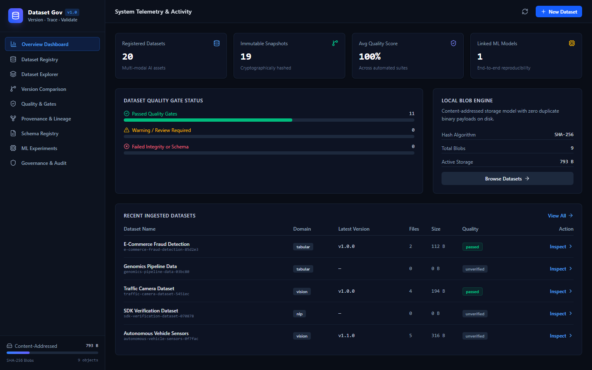
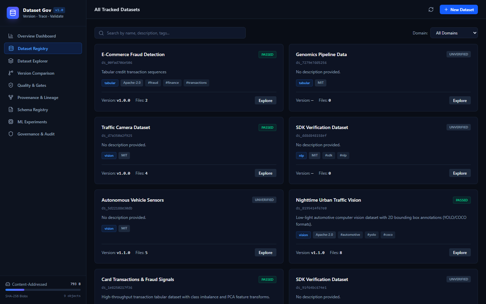
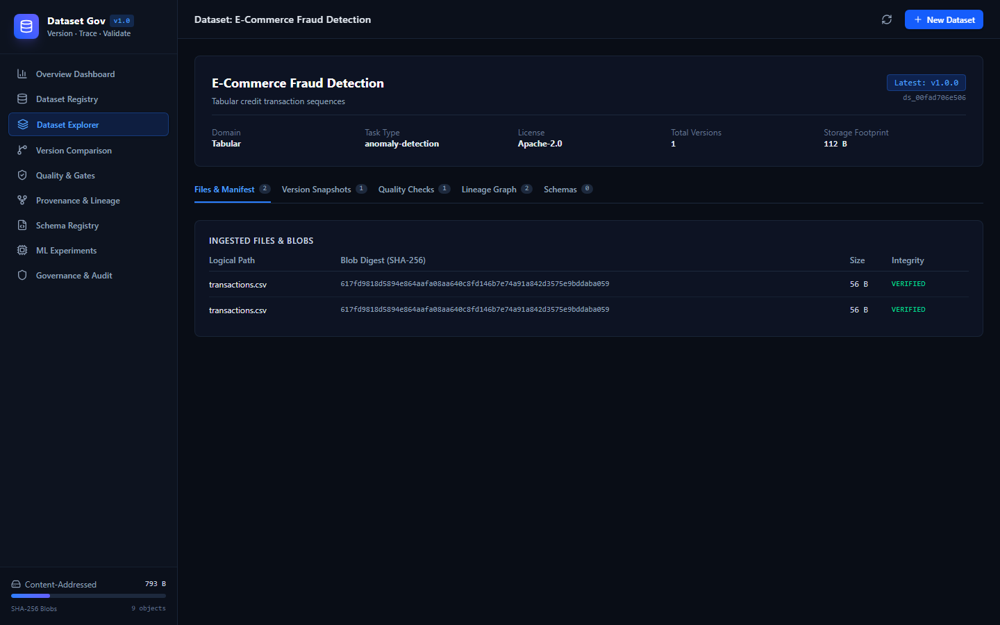
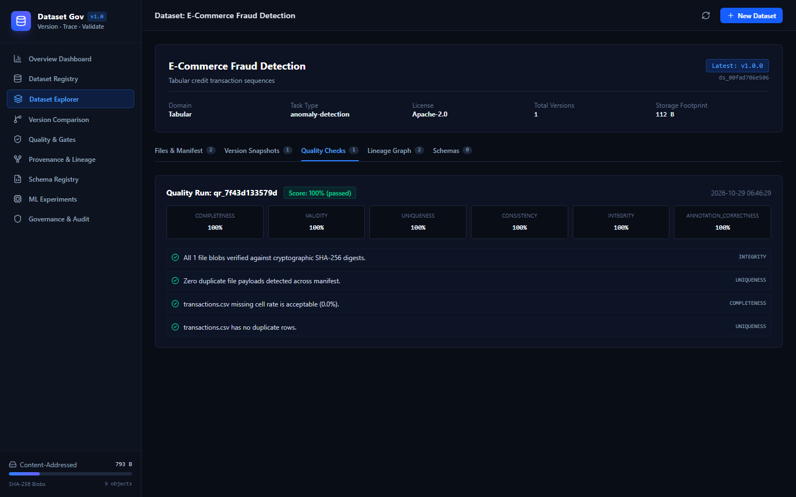
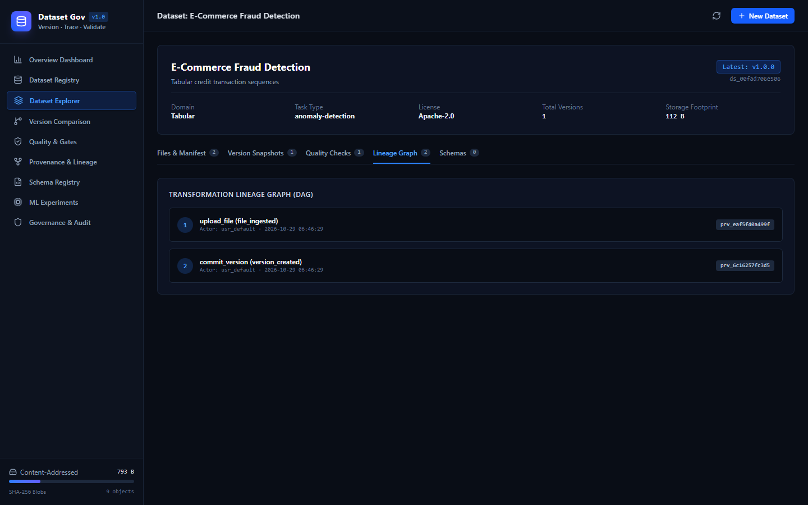
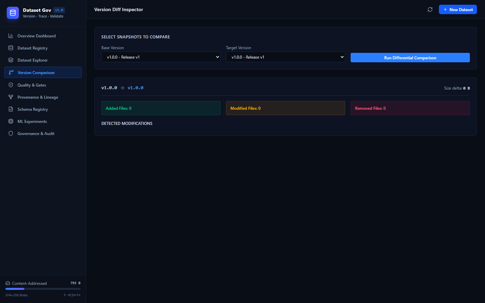
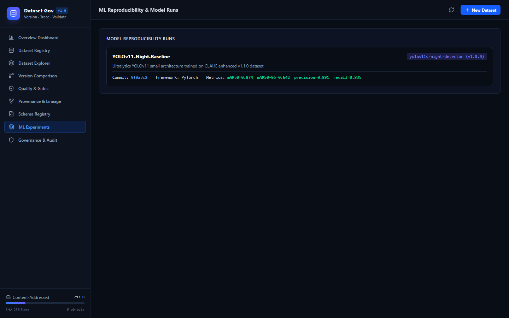
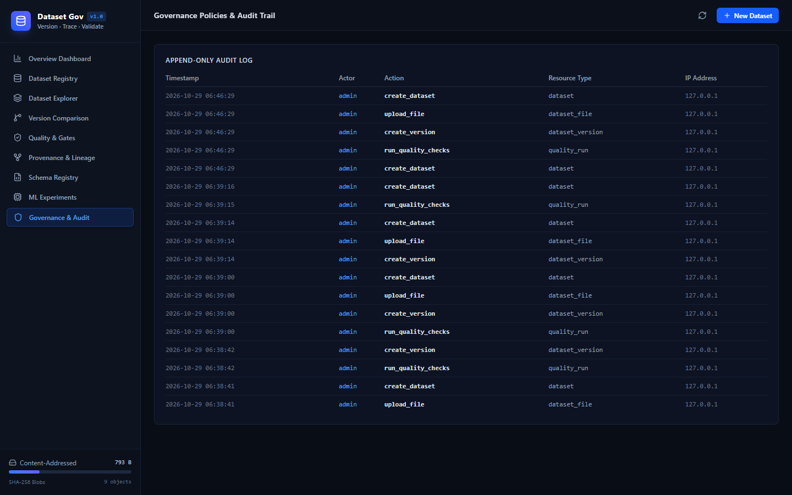

# AI Dataset Governance 🛡️
### AI Dataset Versioning, Provenance & Quality Management Platform

[](https://opensource.org/licenses/MIT)
[](https://www.python.org/)
[](https://fastapi.tiangolo.com/)
[](https://react.dev/)
[](https://tailwindcss.com/)
[](https://www.sqlite.org/)
[](#storage-engine)

> **Version. Trace. Validate. Trust Your Data.**

**AI Dataset Governance** is an open-source, local-first platform for machine learning engineers, data scientists, and researchers to manage datasets throughout their entire lifecycle. It provides immutable versioning, cryptographic integrity checks, automated multi-modal quality validation (Tabular, YOLO, COCO), directed acyclic graph (DAG) provenance tracing, schema evolution detection, and model reproducibility linkages without requiring proprietary cloud subscriptions or mandatory paid APIs.

---

## 📸 Platform Screenshots

### 1. Operations Overview & System Telemetry
Real-time dashboard displaying registered datasets, immutable snapshots, average automated quality score, storage consumption, and quality gate distributions.


### 2. Dataset Registry & Multi-Modal Catalog
Search, filter, and inspect datasets across Computer Vision, Tabular, and NLP domains with license tracking, visibility controls, and tags.


### 3. Dataset Explorer & Content-Addressed File Manifest
Explore dataset file payloads mapped directly to content-addressed SHA-256 blob digests with instantaneous cryptographic verification.


### 4. Automated Data Quality & Quality Gates
Multi-dimensional quality scoring (Completeness, Validity, Uniqueness, Consistency, Integrity, Annotation Correctness) with strict gate criteria for training readiness.


### 5. Artifact Provenance & Lineage DAG
Directed Acyclic Graph (DAG) tracing raw ingestion, transformations (filters, normalizations, image transforms), and version commits with full actor tracking.


### 6. Differential Version Comparison
Differential inspector comparing two immutable snapshots side-by-side: identifying added files, removed files, modified files, byte deltas, and schema evolutions.


### 7. ML Experiments & Reproducibility Linkage
Link model training runs, architectures (e.g. YOLOv11), hyperparameters, metrics (mAP, F1, precision), and Git commits to immutable dataset versions.


### 8. Governance Policies & Append-Only Audit Trail
Append-only operational audit trail recording dataset mutations, quality gate reviews, and license compliance audits.


---

## 🚀 Key Features

- **Local-First & Privacy-Conscious**: 100% self-hostable with zero external data leakage or mandatory LLM dependencies.
- **Content-Addressed Storage (CAS)**: Files are stored and addressed by SHA-256 digests. Duplicate payloads are deduplicated automatically.
- **Immutable Version Snapshots**: Cryptographic manifest hashes lock the exact state of every version commit, enabling deterministic model retraining.
- **Multi-Modal Quality Checks**:
  - **Tabular**: Missing values %, duplicate rows, data type validation, outlier detection.
  - **Computer Vision**: Header corruption detection, dimensions, and image format verification via Pillow.
  - **YOLO Annotations**: Normalized coordinate verification $[0, 1]$, width/height checks, and class bounds.
  - **COCO Annotations**: Schema structural integrity, image-annotation foreign key consistency, and bounding box validation.
- **Provenance & Lineage DAG**: Captures the exact processing history, parameters, actors, and parent transformations leading to any artifact.
- **Schema Governance**: Automatic CSV/JSON schema inference and breaking change detection (column drops, type mismatches, nullability tightening).
- **ML Experiment Linkage**: Links trained models, evaluation metrics, and Git commit SHAs directly to the immutable dataset snapshot used for training.
- **Python SDK & CLI**: First-class command-line tool (`dataset-governance`) and typed Python client (`DatasetClient`) for automated CI/CD pipelines.

---

## 🛠️ Quickstart

### Prerequisites
- Python 3.11+
- Node.js 20+

### Local Development Setup

1. **Clone the repository**:
   ```bash
   git clone https://github.com/0xyz-exe/ai-dataset-governance.git
   cd ai-dataset-governance
   ```

2. **Set up Python environment**:
   ```bash
   uv venv
   uv sync
   ```

3. **Install frontend dependencies & build**:
   ```bash
   cd frontend
   npm install
   npm run build
   cd ..
   ```

4. **Seed initial fixtures & run server**:
   ```bash
   uv run python -m backend.app.seed
   uv run uvicorn backend.app.main:app --port 8000 --reload
   ```

5. **Open in browser**:
   Navigate to [http://localhost:8000](http://localhost:8000).

---

## 💻 Python SDK Usage

```python
from sdk.client import DatasetClient

client = DatasetClient(base_url="http://localhost:8000")

# Fetch dataset
dataset = client.datasets.get("ds_8195414f67e0")

# Record pipeline provenance
with client.provenance.record(
    dataset_id=dataset.id,
    operation="clahe_preprocessing",
    parameters={"clip_limit": 2.0, "tile_grid_size": [8, 8]}
) as run:
    run.add_input("raw_dataset_v1")
    run.add_output("clahe_dataset_v1")

# Create new version snapshot
version = client.datasets.create_version(
    dataset_id=dataset.id,
    semver="v1.1.0",
    description="CLAHE augmented images"
)

# Run automated quality checks
quality = client.datasets.run_quality(dataset_id=dataset.id, version_id=version["id"])
print(f"Overall Quality: {quality['overall_score']}% ({quality['status']})")
```

---

## ⌨️ CLI Commands

```bash
# Initialize storage & SQLite database
python -m cli.main init

# List registered datasets
python -m cli.main dataset list

# Ingest file into dataset
python -m cli.main dataset upload --dataset-id ds_xxx --file ./data/telemetry.csv

# Commit version snapshot
python -m cli.main version create --dataset-id ds_xxx --semver v1.0.0 --desc "Initial release"

# Compare two versions
python -m cli.main version compare --base ver_111 --target ver_222

# Verify cryptographic manifest integrity
python -m cli.main manifest verify --version-id ver_xxx
```

---

## 🧪 Testing & Verification

Run the full automated test suite:
```bash
uv run pytest
```

Output:
```text
============================= test session starts =============================
collected 8 items

tests/test_api.py .                                                      [ 12%]
tests/test_provenance_and_schemas.py ..                                  [ 37%]
tests/test_quality.py .                                                  [ 50%]
tests/test_sdk.py .                                                      [ 62%]
tests/test_storage.py ..                                                 [ 87%]
tests/test_versioning.py .                                               [100%]

======================== 8 passed in 1.16s ====================================
```

---

## 🐳 Docker Deployment

Run the complete platform via Docker Compose:
```bash
docker compose up -d --build
```

Access the UI at `http://localhost:8000`.

---

## 📄 License

Distributed under the [MIT License](LICENSE).
