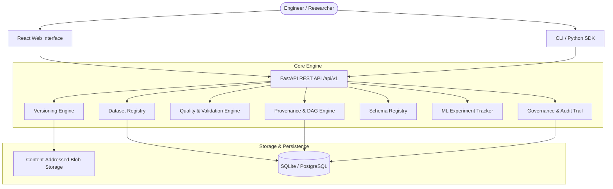

# System Architecture

## Overview

AI Dataset Governance is designed with a local-first, modular architecture that ensures full provenance, deterministic version manifests, and strict quality gates for AI and ML datasets.

## Storage Engine (CAS)

The storage subsystem uses Content-Addressed Storage (CAS) where files are stored under `/data/storage/blobs/xx/<sha256_hash>`.
Identical payload bytes across different versions, filenames, or datasets are automatically deduplicated.
