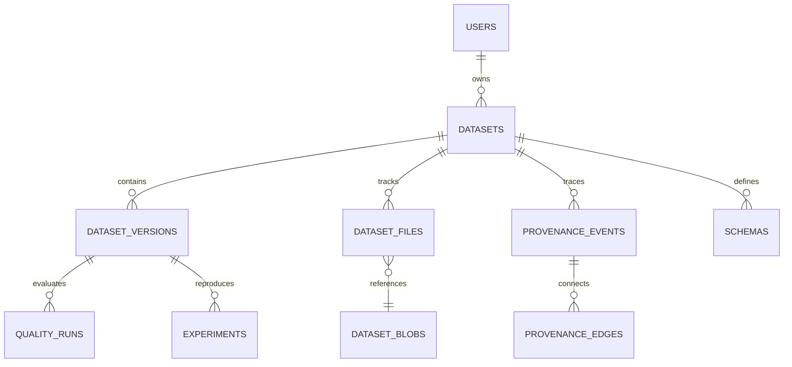

# Database Schema

The database schema supports normalized entity relationships with foreign key integrity and WAL journaling mode.

## Tables Summary

1. `users`: Credentials, RBAC roles (`engineer`, `maintainer`, `admin`).
2. `datasets`: Core dataset metadata, slugs, tasks, domains, licenses.
3. `dataset_blobs`: Content-addressed storage index with SHA-256 digests and reference counting.
4. `dataset_versions`: Immutable snapshot commits, manifest hashes, parent pointers.
5. `dataset_files`: Logical path mapping to underlying blob hashes.
6. `quality_runs`: Quality dimension scores, gate decisions, granular rule findings.
7. `provenance_events`: DAG nodes of ingestion, preprocessing, transforms, and exports.
8. `provenance_edges`: Directed edges linking parent and child lineage operations.
9. `schemas`: Schema versions, field data types, nullability, constraints.
10. `experiments`: ML runs, models, hyperparameters, evaluation metrics, and Git commit references.
11. `audit_logs`: Append-only security and operational audit trail.
